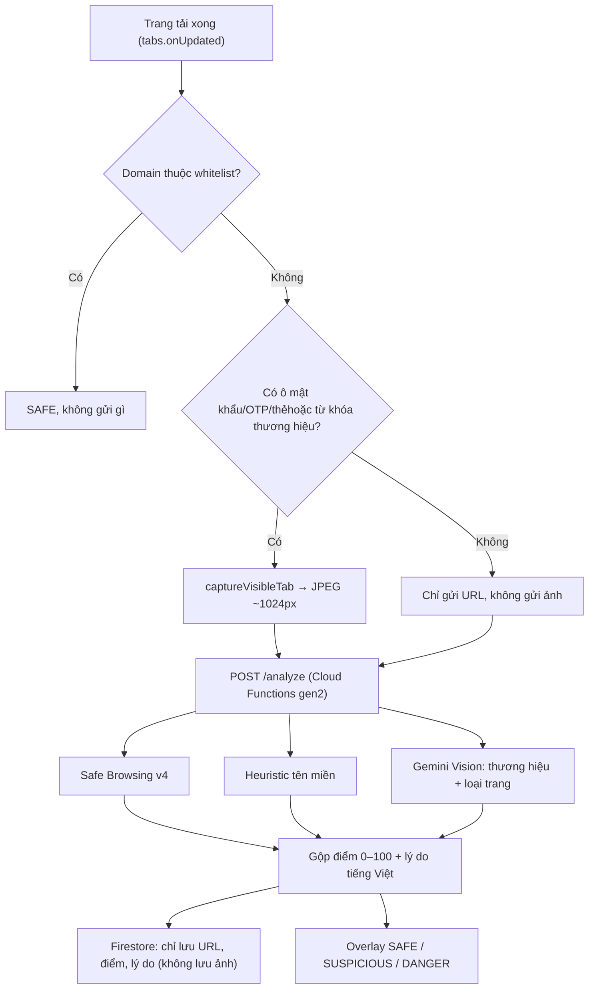

Mục lục

1. [Tóm tắt](#tomtat)
2. [Mốc thời gian](#moc)
3. [Vai trò](#vaitro)
4. [Kiến trúc](#kientruc)
5. [Chấm điểm rủi ro](#diem)
6. [API & schema](#api)
7. [Form đăng ký](#dangky)
8. [Chuẩn bị ≤30%](#chuanbi)
9. [Ngày thi](#ngaythi)
10. [Đo lường](#eval)
11. [Demo Day](#demo)
12. [Hỏi đáp](#qa)
13. [Rủi ro](#rui-ro)
14. [Antigravity](#antigravity)
15. [Thông số đã kiểm](#facts)
16. [Nguồn](#nguon)

GDG DevFest MienTrung 2026 · Mini Hackathon · Bảng An ninh mạng

# VietPhish Lens: kế hoạch triển khai cho đội 3 người

Tiện ích Chrome phát hiện trang giả mạo ngân hàng và cơ quan nhà nước Việt Nam, kể cả trang mới tạo vài giờ chưa có trong danh sách đen, bằng cách so "trang trông giống ai" với "tên miền thật là của ai".

Build: sáng 14/11/2026 (\~4,5 giờ) Demo: chiều 14/11 Làm trước tối đa 30% Bắt buộc: Antigravity + ≥1 công nghệ Google Cập nhật: 12/10/2026 (thêm lối vào cho điện thoại, kiểm tra file cài đặt, khám bảo mật website)

## 01Tóm tắt

**Nguyên tắc lõi:** trang *trông giống* thương hiệu X, *tên miền không thuộc* X, và *đòi* mật khẩu/OTP/số thẻ, thì gần như chắc chắn là lừa đảo. Không cần chờ ai báo cáo trang đó.

Pipeline 4 lớp: **whitelist** → **Google Safe Browsing** → **heuristic tên miền** (punycode, ký tự nhái, khoảng cách chữ, đuôi lạ, subdomain lừa) → **Gemini Vision** nhận diện thương hiệu từ ảnh chụp trang. Cuối cùng gộp thành điểm 0–100 và cảnh báo bằng tiếng Việt kèm lý do.

**SAFE \< 40**Huy hiệu xanh, không làm phiền

**SUSPICIOUS 40–69**Banner vàng ở đầu trang

**DANGER ≥ 70**Phủ đỏ toàn trang, nêu lý do, nút về trang chính thức

**Ba lối vào, một backend (bổ sung 12/10)**

1. **Tiện ích Chrome** (máy tính): tự kiểm tra trang đang mở. Đây vẫn là phần lõi.
2. **Trang web "Hỏi trước khi bấm"** (điện thoại): dán link hoặc tải ảnh chụp tin nhắn SMS/Zalo đáng ngờ, nhận câu trả lời "có phải lừa đảo không, vì sao". Không cần cài gì, gửi được cho ông bà, cha mẹ.
3. **Hai chức năng quét mở rộng** (làm sau cùng, cắt đầu tiên nếu thiếu giờ): cảnh báo link tải file cài đặt (APK giả VNeID/ngân hàng) và "khám nhanh" bảo mật một website theo kiểu thụ động.

**Ba thứ phải có trên sân khấu**

(1) Trang giả trên tên miền mới bị chặn trong khi Safe Browsing vẫn báo "sạch". (2) Lý do cảnh báo bằng tiếng Việt dễ hiểu. (3) Bảng số đo so sánh 3 cấu hình: chỉ blacklist, chỉ heuristic, heuristic + Gemini.

**Không tuyên bố "đầu tiên"**

Hướng "logo giống thương hiệu nhưng domain khác" đã có trong nghiên cứu (Phishpedia, PhishIntention, VisualPhishNet). Chrome Enhanced Protection cũng dùng Gemini Nano. Điểm khác của mình là: thương hiệu Việt, dùng mô hình ngôn ngữ thị giác nên không cần huấn luyện, lý do giải thích bằng tiếng Việt, và có số đo trên dữ liệu Việt Nam.

## 02Mốc thời gian

| Khi nào | Việc | Đầu ra |
| --- | --- | --- |
| 10/10 → hạn đơn | Nộp form đăng ký (form mở 5/10; **kiểm tra hạn đóng đơn** trên form) | Đơn nộp xong, dùng khung trả lời ở mục 07 |
| +3–4 ngày | BTC gửi kết quả vòng đơn | Xác nhận được thi |
| Tuần 1–2 | Tài khoản, API key, whitelist, bộ dữ liệu | `official_domains.json`, `labels.csv` |
| Tuần 3 | Thiết kế UI, khung rỗng, trang demo giả, thử tay prompt | Mockup, scaffold chạy "hello", 2 trang demo |
| Tuần 4 (trước 14/11) | Tổng duyệt: laptop, file hosts, hotspot, quota; khóa nhánh `prep` | Tag `pre-event`, `PREBUILT.md` |
| Sáng 14/11 | Build theo lịch ở mục 09 | Tag `v1.0-demo`, video dự phòng |
| Chiều 14/11 | Demo Day: pitch và hỏi đáp | Theo kịch bản mục 11 |

## 03Vai trò

A

#### Extension / Frontend

Tiện ích Chrome MV3: bắt sự kiện tải trang, chụp màn hình, gọi API, overlay cảnh báo (Shadow DOM), popup. Điều khiển máy khi demo.

B

#### Backend / AI

Cloud Functions for Firebase: whitelist, Safe Browsing, heuristic tên miền, Gemini Vision, công thức điểm, Firestore. Dẫn phần giải pháp khi pitch.

C

#### Data / Eval / Pitch

Whitelist tên miền, bộ dữ liệu có nhãn, script đo, trang demo giả, slide, video dự phòng. Mở đầu và trình bày kết quả khi pitch.

## 04Kiến trúc

Ảnh chụp chỉ được gửi khi trang *không* thuộc whitelist và có dấu hiệu nhạy cảm (ô mật khẩu/OTP/số thẻ, hoặc tên miền có từ khóa thương hiệu). API key chỉ nằm ở server.



### Lối vào web "Hỏi trước khi bấm"

Một trang tĩnh trên Firebase Hosting, mở được trên điện thoại, gọi cùng `/analyze` với `source: "web"`.

- **Dán link:** chạy whitelist → Safe Browsing → heuristic tên miền. Không có ảnh trang nên không có lớp nhìn trang; kết quả ghi rõ "chỉ kiểm tra địa chỉ".
- **Tải ảnh chụp tin nhắn:** Gemini đọc ảnh, trả về *tin nhắn tự xưng là ai*, *đòi làm gì* và *các link trong ảnh*. Code so thương hiệu tự xưng với tên miền của link, đúng nguyên tắc lõi: "tự xưng X, link không phải của X, đòi OTP/chuyển tiền/cài app".
- Server **không mở** link trong tin nhắn (không dựng trình duyệt ẩn trong 4,5 giờ, và tránh tự truy cập trang độc hại).

### Chức năng quét mở rộng

| Chức năng | Làm gì | Giới hạn |
| --- | --- | --- |
| **Kiểm tra link tải file cài đặt** | Link kết thúc bằng `.apk/.exe/.msi/.dmg`, hoặc trang có nút tải file ngoài CH Play/App Store → cảnh báo `APK_OUTSIDE_STORE`. Nếu có key VirusTotal (thuộc Google): tra báo cáo theo URL/hash, **chỉ tra cứu, không tải file lên**. | Không tự phân tích mã độc. VirusTotal "sạch" không có nghĩa là an toàn; nói rõ điều này trên giao diện. |
| **Khám nhanh bảo mật website** (`POST /site-check`) | Gửi **một** yêu cầu GET như trình duyệt bình thường rồi chấm: HTTPS và chuyển hướng, hạn chứng chỉ, các header bảo mật (HSTS, CSP, X-Frame-Options, X-Content-Type-Options), cờ cookie (Secure, HttpOnly, SameSite), form mật khẩu gửi qua HTTP, phiên bản phần mềm lộ trong header. Gemini viết lại kết quả thành lời khuyên tiếng Việt cho chủ website nhỏ. | **Chỉ thụ động.** Không dò cổng, không thử payload, không dò thư mục, không quét hàng loạt. Quét chủ động website không phải của mình khi chưa được phép là vi phạm pháp luật; công cụ này không làm việc đó. |

### Stack

| Phần | Chọn | Vì sao |
| --- | --- | --- |
| Trang web | HTML tĩnh trên Firebase Hosting | Thêm một công nghệ Google, deploy chung lệnh, mở được trên điện thoại giám khảo qua mã QR |
| Tra cứu file | VirusTotal API v3 (tùy chọn) | Chỉ tra báo cáo có sẵn; thiếu key thì vẫn chạy cảnh báo theo luật |
| Extension | Chrome MV3, TypeScript + Vite (hoặc JS thuần) | Overlay trong Shadow DOM để CSS của trang không phá giao diện cảnh báo |
| Backend | Cloud Functions for Firebase gen2 (Node 20, TS) | Deploy 1 lệnh, đi chung project với Firestore; `defineSecret` giữ key; `minInstances: 1` ngày demo để tránh khởi động nguội |
| AI | `gemini-3.5-flash-lite`, dự phòng `gemini-3.8-flash` | Nhanh, rẻ, có vision và đầu ra JSON theo schema. Ghi model ID trong config vì Google đổi model rất nhanh |
| Blacklist | Safe Browsing Lookup API v4 | Miễn phí cho mục đích phi thương mại. Nhắc Web Risk khi nói về thương mại hóa |
| Thư viện | `tldts`, `punycode`, `fastest-levenshtein`, `confusables` | Tách eTLD+1, giải mã punycode, khoảng cách chữ, ký tự nhái |
| Lưu trữ | Firestore | Log phát hiện, báo cáo của người dùng, cache theo domain |

### Cấu trúc repo

```
vietphish-lens/
├─ extension/    manifest.json, src/background.ts, src/content.ts, src/overlay/, src/popup/
├─ server/       src/index.ts, src/pipeline/{whitelist,safebrowsing,heuristics,vision,fusion}.ts,
│                src/reasons.vi.ts, fusion.config.json, test/
├─ shared/       types.ts (hợp đồng API), official_domains.json
├─ eval/         dataset/{fake,real}/, labels.csv, phishvn_sample.csv, run_eval.ts, results/
├─ demo-sites/   vcb-fake/, vneid-fake/ (có watermark), serve.js, hosts.sample
└─ docs/         PREBUILT.md, process/ (artifact Antigravity, ảnh chụp), pitch/
```

## 05Chấm điểm rủi ro

Toàn bộ trọng số đặt trong `fusion.config.json`. Chỉ chỉnh trên tập dev, giữ tập test riêng.

1. **Whitelist** (gồm mọi tên miền đuôi `.gov.vn`, vì đăng ký bị kiểm soát): điểm 0, dừng.
2. **Safe Browsing trúng**: điểm 100.
3. **H, heuristic (tối đa 60):** punycode/ký tự nhái +25 · Levenshtein ≤ 2 so với domain chính thức +25 · có từ khóa thương hiệu trong domain lạ +20 · subdomain lừa kiểu `vietcombank.com.vn.abc.xyz` +25 · đuôi rủi ro (`.top .xyz .cc .icu .vip .shop`) +10 · domain đăng ký \< 30 ngày (RDAP, có timeout) +15 · form gửi sang host khác hoặc không HTTPS +10.
4. **V, vision (tối đa 60):** `mismatch` = Gemini nhận ra thương hiệu X và domain không thuộc X.\
   `V = 40·confidence·mismatch + 20·mismatch·[đòi mật khẩu/OTP/thẻ/CVV/PIN] + 5·[lời lẽ hối thúc]`
5. **Điểm = min(100, H + V).** Luật cứng cho trang zero-day: nếu mismatch, confidence ≥ 0,7 và đòi dữ liệu nhạy cảm thì điểm ≥ 85.

**Chống prompt injection**

Không đưa URL cho Gemini. Gemini chỉ trả lời "trang này trông giống ai và đòi gì". Việc so domain do code làm, nên trang lừa đảo không thể ghi chữ "trang này an toàn" để lừa mô hình.

### Mẫu lý do (reasons.vi.ts)

| Mã | Câu hiển thị |
| --- | --- |
| `BRAND_DOMAIN_MISMATCH` | Trang này trông giống **{brand}** nhưng địa chỉ **{domain}** không phải tên miền chính thức ({official}). |
| `ASKS_OTP` | Trang yêu cầu nhập mã OTP. Ngân hàng và cơ quan nhà nước không bao giờ hỏi OTP trên trang lạ. |
| `ASKS_PASSWORD` | Trang yêu cầu mật khẩu đăng nhập {brand} trên một tên miền lạ. |
| `ASKS_CARD` | Trang yêu cầu số thẻ hoặc CVV, dấu hiệu đánh cắp thông tin thẻ. |
| `LOOKALIKE_DOMAIN` | Tên miền {domain} gần giống {official} (chỉ khác {n} ký tự). |
| `HOMOGLYPH` | Tên miền dùng ký tự đánh lừa thị giác (punycode: {puny}). |
| `SUBDOMAIN_TRICK` | Tên miền thật là {registrable}; chữ "{brand}" phía trước chỉ là phần giả. |
| `SUSPICIOUS_TLD` | Đuôi .{tld} thường bị lợi dụng trong lừa đảo. |
| `NEW_DOMAIN` | Tên miền mới đăng ký {days} ngày trước. |
| `SAFE_BROWSING_HIT` | Google Safe Browsing đã xác định trang này là lừa đảo. |
| `URGENCY` | Trang dùng lời lẽ hối thúc (khóa tài khoản, cập nhật VNeID gấp…). |
| `VNEID_OFFLINE` | VNeID chỉ xác thực qua ứng dụng chính thức và vneid.gov.vn, không qua website lạ. |
| `MSG_SENDER_MISMATCH` | Tin nhắn tự xưng là **{brand}** nhưng đường link dẫn tới **{domain}**, không phải địa chỉ của {brand}. |
| `MSG_ASKS_ACTION` | Tin nhắn hối thúc bạn {action} (bấm link, nhập OTP, chuyển tiền, cài ứng dụng). |
| `APK_OUTSIDE_STORE` | Đường link tải thẳng file cài đặt. {brand} chỉ phát hành ứng dụng trên CH Play và App Store. |
| `VT_FLAGGED` | {n} trình diệt virus trên VirusTotal đã đánh dấu địa chỉ/file này là độc hại. |
| `LINK_ONLY_CHECK` | Mới chỉ kiểm tra địa chỉ, chưa xem nội dung trang. Chưa thấy dấu hiệu xấu không có nghĩa là an toàn. |

## 06API và schema

Chốt `shared/types.ts` ngay 15 phút đầu ngày thi. Sau đó không ai đổi mà không báo nhóm.

### POST /analyze: request

```
{
  "url": "https://vietcombank-xacthuc.top/login",
  "title": "Vietcombank - Đăng nhập",
  "screenshot": "data:image/jpeg;base64,...",
  "signals": {
    "hasPasswordField": true,
    "hasOtpField": false,
    "formActionHost": "api.abc.xyz"
  },
  "mode": "full"
}
// mode: full | no_vision | blacklist_only (dùng cho eval)
```

### Response

```
{
  "verdict": "DANGER",
  "riskScore": 92,
  "brand": { "id": "vietcombank",
    "officialUrl": "https://vietcombank.com.vn" },
  "reasons": [{ "code": "BRAND_DOMAIN_MISMATCH",
    "text": "...", "weight": 40 }],
  "layers": { "whitelist": false,
    "safeBrowsing": "clean", "heuristics": 37 },
  "latencyMs": { "total": 2140, "vision": 1830 },
  "degraded": false
}
```

### Schema đầu ra Gemini

```
{
  "brand_detected": "vietcombank | vietinbank | bidv | agribank | techcombank | mbbank | acb | vpbank
                     | tpbank | sacombank | vneid | dichvucong | thue | bhxh | momo | zalopay | none",
  "confidence": 0.0,
  "page_type": "login | otp | payment | info | other",
  "asks_sensitive_data": ["password", "otp", "card_number", "cvv", "cccd", "pin"],
  "visual_evidence": ["logo Vietcombank góc trái", "ô nhập mã OTP"],
  "urgency_language": true
}
```

`brand_detected` là enum để mô hình không bịa ra thương hiệu ngoài danh sách. Server gọi song song Safe Browsing, heuristic và Gemini (`Promise.allSettled`), Gemini timeout 6 giây. Quá hạn thì trả kết quả từ heuristic kèm `degraded: true`.

### Bổ sung cho lối vào web và chức năng quét

`/analyze` nhận thêm `source: "extension" | "web"` và `input: "page" | "link" | "message"`. Với `input: "message"`, trường `screenshot` là ảnh chụp tin nhắn và `url` để trống; Gemini dùng schema riêng:

```
{
  "claimed_sender": "<cùng enum brand_detected>",
  "confidence": 0.0,
  "urls_in_image": ["https://..."],
  "requested_actions": ["click_link", "enter_otp", "transfer_money", "install_app", "call_number"],
  "urgency_language": true
}
```

Mỗi URL đọc được từ ảnh đi qua whitelist, Safe Browsing và heuristic như bình thường. Ảnh tin nhắn không được lưu.

```
POST /site-check   { "url": "https://cuahang-abc.vn" }
→ { "grade": "C", "checks": [{ "id": "hsts", "pass": false, "text": "..." }], "advice": "..." }
```

`/site-check` chỉ gửi một GET, timeout 5 giây, giới hạn tần suất theo IP, chặn địa chỉ nội bộ (`localhost`, `10.x`, `192.168.x`, `169.254.x`) để không bị lợi dụng dò mạng trong.

**SDK đã đổi cách gọi**

Docs hiện tại của `@google/genai` (v2.28) dùng **Interactions API**: `ai.interactions.create(...)`, schema đặt trong `response_format`. Ngày 26/5/2026 có thay đổi phá vỡ tương thích (`outputs` → `steps`). B phải chạy thử đúng phiên bản SDK trong tuần chuẩn bị và ghi lại cách đọc response.

```
import { GoogleGenAI } from "@google/genai";
const ai = new GoogleGenAI({ apiKey: process.env.GEMINI_API_KEY });
const r = await ai.interactions.create({
  model: config.visionModel,               // "gemini-3.5-flash-lite"
  input: [
    { type: "text",  text: PROMPT_VI },
    { type: "image", data: jpegBase64, mime_type: "image/jpeg" }
  ],
  response_format: { type: "text", mime_type: "application/json", schema: BRAND_SCHEMA }
});
```

## 07Khung trả lời form đăng ký

Form có 11 câu; ba câu dưới đây cần nội dung về dự án. Các câu còn lại là thông tin cá nhân (mỗi thành viên cần **link CV và size áo**).

### Câu 6 · Tên ý tưởng (dùng làm tên nhóm)

VietPhish Lens

### Câu 7 · Mô tả ý tưởng (bài toán, đối tượng, đóng góp cho địa phương)

> **VietPhish Lens: hỏi trước khi bấm.** Công cụ giúp người Việt biết một trang web, đường link hay tin nhắn có phải lừa đảo hay không, và giải thích lý do bằng tiếng Việt dễ hiểu.
>
> **Bài toán.** NCSC đã ghi nhận khoảng 125.600 địa chỉ web giả mạo; riêng VNeID giả có hơn 21.800 phản ánh chỉ trong 5 tuần. Trang lừa đảo thường chỉ sống vài giờ trên tên miền mới, nên các danh sách đen luôn chậm một bước. Người dùng thì không đọc địa chỉ web, nhất là trên điện thoại.
>
> **Giải pháp.** Thay vì chờ ai đó báo cáo, hệ thống kiểm tra theo một nguyên tắc: *trông giống hoặc tự xưng là thương hiệu X, nhưng địa chỉ không phải của X, lại đòi mật khẩu/OTP/chuyển tiền/cài ứng dụng* thì cảnh báo. Bốn lớp kiểm tra: danh sách tên miền chính thức của ngân hàng và cơ quan nhà nước Việt Nam, Google Safe Browsing, phân tích tên miền nhái, và Gemini nhìn ảnh để nhận ra thương hiệu bị giả mạo. Có ba cách dùng trên cùng một hệ thống:
> 1. Tiện ích Chrome tự kiểm tra trang đang mở và phủ cảnh báo đỏ kèm lý do.
> 2. Trang web dùng được trên điện thoại, không cần cài đặt: dán link hoặc tải ảnh chụp tin nhắn SMS/Zalo đáng ngờ để hỏi.
> 3. Cảnh báo link tải file cài đặt ngoài CH Play/App Store (thủ đoạn VNeID giả), và "khám nhanh" bảo mật website cho chủ cửa hàng, cơ sở lưu trú nhỏ (chỉ kiểm tra thụ động: HTTPS, chứng chỉ, cấu hình bảo mật).
>
> **Đối tượng.** Người dùng ngân hàng số và dịch vụ công trực tuyến, đặc biệt là người lớn tuổi và người ít rành công nghệ; con cháu có thể gửi trang kiểm tra cho ông bà, cha mẹ. Nhóm thứ hai là hộ kinh doanh và doanh nghiệp nhỏ có website nhưng không có người làm bảo mật.
>
> **Đóng góp.** Miền Trung đang đẩy mạnh dịch vụ công trực tuyến, thanh toán không tiền mặt và du lịch; đây cũng là lúc người dân và các cơ sở kinh doanh nhỏ dễ thành mục tiêu của trang giả mạo. Công cụ miễn phí, bằng tiếng Việt, giúp người dân tự bảo vệ trước khi mất tiền, và có thể chia sẻ dữ liệu trang giả mới phát hiện cho cơ quan chức năng. Nhóm sẽ công bố số đo (tỷ lệ phát hiện, tỷ lệ báo nhầm, độ trễ) trên dữ liệu Việt Nam thay vì chỉ trình diễn.
>
> *[Tùy quyết định của nhóm sau khi hỏi BTC:]* Nhóm đã làm một bản thử nghiệm nhỏ để kiểm chứng ý tưởng; toàn bộ mã dự thi sẽ được viết lại trong ngày hackathon bằng Antigravity.

Trước khi nộp: đối chiếu lại hai số liệu NCSC với nguồn ở mục 16, và sửa câu về miền Trung cho đúng với nơi nhóm sinh sống/học tập.

### Câu 8 · Công nghệ Google

Gemini API (đọc ảnh, đầu ra có cấu trúc) · Google Safe Browsing API · Cloud Functions for Firebase · Firestore · Firebase Hosting · Secret Manager · Chrome Extensions (Manifest V3) · Google Antigravity · VirusTotal (thuộc Google, tùy chọn).

### Ghi chú khi pitch (không đưa vào form)

- **Khác biệt:** ChongLuaDao dựa vào blacklist cộng đồng. Chrome Enhanced Protection không chuyên về thương hiệu Việt. Các nghiên cứu như Phishpedia cần huấn luyện và không có thương hiệu Việt.
- **Đo lường:** bộ dữ liệu có nhãn và so sánh 3 cấu hình theo precision, recall, tỷ lệ báo nhầm và độ trễ.
- **Đạo đức:** không truy cập hay phát tán trang lừa đảo thật. Trang demo do đội tự dựng, có watermark, chạy local. Khám bảo mật website chỉ ở mức thụ động.
- **Đội:** A Extension/UI · B Backend/AI · C Data/Eval/Pitch, ghi kèm kỹ năng thật của từng người.

## 08Chuẩn bị trước sự kiện (giữ ≤ 30%)

Chỉ làm dữ liệu, thiết kế, khung rỗng, tài khoản. Mọi thứ làm trước được ghi trong `docs/PREBUILT.md` và commit ở nhánh `prep` có tag `pre-event` để BTC đối chiếu. Ô tích bên dưới chỉ lưu trên trình duyệt của bạn.

#### A · Extension

- [ ] Mockup overlay DANGER, banner SUSPICIOUS, popup, trạng thái "đang kiểm tra"
- [ ] Scaffold MV3 rỗng: manifest (`tabs, activeTab, storage, scripting` + host `<all_urls>`), service worker in "hello", Load unpacked chạy được
- [ ] Thử nhanh `captureVisibleTab` (tối đa 2 lần/giây; tự động cần `<all_urls>`), ghi kết luận rồi xóa code thử
- [ ] Thử file hosts trên laptop demo; tắt "Use secure DNS" trong Chrome nếu hosts bị bỏ qua
- [ ] Cài Antigravity, chạy thử Agent Manager 1 phiên

#### B · Backend / AI

- [ ] Tạo project Firebase (gói Blaze, đặt cảnh báo ngân sách 5 USD); bật Gemini API, Safe Browsing, Firestore, Secret Manager
- [ ] `firebase init functions` (TS), deploy `/health` rỗng
- [ ] Thử tay prompt và schema trong AI Studio với 5 ảnh; ghi kết quả vào docs
- [ ] Chạy thử SDK `@google/genai` bản hiện hành, ghi cách đọc response (Interactions API)
- [ ] Xem giới hạn free tier tại AI Studio; tạo key dự phòng ở project thứ 2

#### C · Data / Eval / Pitch

- [ ] `official_domains.json` khoảng 20 thương hiệu, **kiểm tay từng domain** (xem mục 15)
- [ ] Tải PhishVN, lọc nhóm bank/government/tax, lấy khoảng 300 URL giả + 300 URL thật (Tranco) cho đo heuristic
- [ ] 60 cặp ảnh + URL có nhãn (30 giả / 30 thật), chia dev 20 / test 40. Ảnh giả lấy từ bài cảnh báo trên báo và ngân hàng, **không mở trang lừa đảo thật**
- [ ] 2 trang demo HTML tĩnh (VCB đăng nhập, VNeID OTP), watermark "DEMO – KHÔNG PHẢI TRANG THẬT", `noindex`, form không gửi đi đâu
- [ ] Slide "Ai trả tiền" và 3 lần tập pitch 4 phút có bấm giờ trong tuần 4
- [ ] Khung 7 slide, dàn ý pitch, dàn ý video dự phòng; tìm 1 vụ lừa đảo thật đã lên báo để mở đầu

#### Bổ sung 12/10 · Lối vào web và chức năng quét

- [ ] A: mockup trang "Hỏi trước khi bấm" trên điện thoại (ô dán link, nút tải ảnh, thẻ kết quả)
- [ ] B: bật Firebase Hosting; thử tay trong AI Studio 5 ảnh chụp tin nhắn với schema `claimed_sender`
- [ ] B: đăng ký key VirusTotal, đọc giới hạn gói miễn phí và điều khoản sử dụng
- [ ] C: 20 ảnh chụp tin nhắn có nhãn (10 lừa đảo lấy từ bài cảnh báo trên báo, 10 tin thật của ngân hàng/nhà mạng), che số điện thoại cá nhân
- [ ] C: danh sách 5 website **của chính nhóm hoặc đã xin phép** để demo khám bảo mật

#### KHÔNG làm trước

- Logic heuristic, client Gemini, công thức điểm
- Overlay hoạt động thật, logic `background.ts`
- Script eval chạy được, dashboard

Tất cả viết trong ngày thi bằng Antigravity, lưu artifact làm bằng chứng cho tiêu chí "Quá trình thực hiện".

## 09Ngày thi, theo giờ

Giờ bắt đầu chính xác chưa công bố. Bảng dưới tính từ T0 = lúc được phép code, giả định 4,5 giờ.

| Mốc | A · Extension | B · Backend / AI | C · Data / Eval |
| --- | --- | --- | --- |
| T0–0:15 | Cả đội chốt `shared/types.ts`, mở workspace Antigravity cho từng người, chụp màn hình bắt đầu |  |  |
| 0:15–1:00 | `tabs.onUpdated` → whitelist cục bộ → chụp + nén → gọi `/analyze` (dùng mock trước) | Khung `/analyze` + whitelist + Safe Browsing | Bật demo-sites + hosts; khung `run_eval.ts` đọc CSV, gọi API theo `mode` |
| 1:00–1:45 | Overlay Shadow DOM tiếng Việt, đọc `reasons` | `vision.ts` (Gemini + schema) và `heuristics.ts` (tldts, Levenshtein, punycode, TLD, subdomain) | Unit test heuristic với 15 domain mẫu; kiểm schema cùng B |
| 1:45 · CP1 | Ghép thật: extension → server đã deploy → overlay đỏ trên trang VCB giả. C quay video dự phòng lần 1. |  |  |
| 2:00 · MDP | Sản phẩm demo được tối thiểu: cả 3 kịch bản chạy từ đầu đến cuối, dù lý do còn thô |  |  |
| 2:00–3:00 | **Trang web "Hỏi trước khi bấm"** (dán link, tải ảnh tin nhắn) trước; popup và huy hiệu "đang kiểm tra" sau | `fusion.ts` + luật cứng + `reasons.vi.ts`; nhánh `input: "message"`; log Firestore; timeout và `degraded` | Chạy eval 3 cấu hình trên tập dev → chỉnh ngưỡng một lần → khóa config |
| 3:00 · CP2 | Đóng băng tính năng. Chạy lại 3 kịch bản, merge vào `main`. C chạy eval trên tập test và PhishVN. |  |  |
| 3:00–3:45 | Chế độ `DEMO_OFFLINE` đọc `demo-cache.json` | `minInstances: 1`, làm nóng cache; nếu dư giờ: `APK_OUTSIDE_STORE`, rồi `/site-check` | Slide kết quả: bảng 3 cấu hình, độ trễ p50/p95 |
| 3:45–4:15 | Sửa lỗi UI, câu chữ | Sửa lỗi, giới hạn tần suất đơn giản; 3:45 tập pitch lần 1 cùng C | Quay video dự phòng bản cuối (\~90 giây, 3 kịch bản) |
| 4:15–4:30 | Tag `v1.0-demo`, xuất artifact Antigravity vào `docs/process/`, tập pitch lần 2 cả đội có bấm giờ và hỏi đáp |  |  |

### Luật cắt phạm vi

- Đến 2:00 chưa có MDP: bỏ popup, dashboard, RDAP; A dùng banner đơn giản thay overlay.
- Gemini lỗi hoặc chậm sau 2:15: demo bằng kết quả đã cache, trình bày eval với cấu hình heuristic, nói thẳng với giám khảo.
- Đến 3:00 eval chưa chạy: thu còn 30 mẫu (15/15), vẫn giữ 3 cấu hình.
- Thứ tự cắt: tra cứu VirusTotal → `/site-check` → dashboard → RDAP → nút Báo cáo → popup → cảnh báo APK → tải ảnh tin nhắn → banner SUSPICIOUS → ô dán link.
- Hai chức năng quét mở rộng chỉ bắt đầu sau CP2 (3:00) và chỉ khi 3 kịch bản chính đã chạy ổn. Một sản phẩm hoàn thiện ít tính năng ghi điểm cao hơn nhiều tính năng dang dở.
- Không bao giờ cắt: overlay DANGER, lý do tiếng Việt, bảng số đo.

## 10Đo lường

Đây là phần ghi điểm "Công nghệ/Kỹ thuật". Hai tầng đo, cùng chạy bằng `eval/run_eval.ts`.

| Tầng | Dữ liệu | Đo gì |
| --- | --- | --- |
| Tên miền (quy mô lớn) | Khoảng 600 URL từ PhishVN (nhóm bank/gov/tax) + Tranco | Recall và tỷ lệ báo nhầm của riêng heuristic; không cần ảnh nên chạy nhanh |
| Thị giác (end-to-end) | 60 cặp ảnh + URL, test 40 mẫu | Precision, recall, tỷ lệ báo nhầm, độ trễ p50/p95 cho 3 cấu hình |

Ba cấu hình: `blacklist_only` (Safe Browsing lúc chạy) · `no_vision` (whitelist + Safe Browsing + heuristic) · `full` (thêm Gemini). Thông điệp mong đợi: blacklist bắt kém với trang mới; thêm Gemini thì recall tăng mà báo nhầm vẫn thấp. **Báo đúng số đo được, kể cả khi không đẹp**, và nêu hạn chế: mẫu nhỏ, một phần trang giả do đội tự dựng.

**Cẩn thận dữ liệu bị lẫn**

URL trong PhishVN có thể đã nằm trong Safe Browsing, nên cấu hình `blacklist_only` sẽ trông tốt trên tập đó. Phần "zero-day" chỉ chứng minh được bằng trang tự dựng trên tên miền mới chưa ai báo cáo.

## 11Demo Day

Giả định 4 phút pitch + 4 phút hỏi đáp (giống năm 2025). Kiểm tra lại khi BTC công bố.

| Thời gian | Ai | Nội dung |
| --- | --- | --- |
| 0:00–0:20 | C nói, A thao tác | **Mở bằng hình, không mở bằng sơ đồ:** màn hình đang ở trang Vietcombank giả, overlay đỏ bật lên ngay. "Trang này mới tạo sáng nay, chưa danh sách đen nào biết. Công cụ của chúng tôi chặn nó trong một giây." |
| 0:20–0:45 | C | Vấn đề: một vụ lừa đảo **thật đã lên báo** và một số liệu NCSC; blacklist chậm một bước, người dùng không đọc URL. Không bịa chuyện người thân. |
| 0:45–2:15 | A thao tác, B dẫn | 1. `vietcombank.com.vn` → huy hiệu xanh, không gửi ảnh. 2. `vietcombank-xacthuc.top` (Safe Browsing báo sạch) → phủ đỏ, đọc 3 lý do, bấm "Về trang chính thức". 3. `vneid-capnhat.cc` đòi OTP → cảnh báo `ASKS_OTP` + `VNEID_OFFLINE`. 4. Trên điện thoại: tải ảnh chụp một tin nhắn giả ngân hàng lên trang "Hỏi trước khi bấm" → `MSG_SENDER_MISMATCH`; chiếu mã QR để giám khảo tự thử. Nếu đã làm xong: một lượt khám bảo mật website của chính nhóm (20 giây). |
| 2:15–2:40 | B | Sơ đồ 4 lớp, chỉ sau khi giám khảo đã thấy sản phẩm chạy. Câu chốt: "Nhìn giống X, nhưng không phải nhà của X, lại đòi OTP." |
| 2:40–3:10 | C | Bảng 3 cấu hình, độ trễ p50, chi phí ước tính mỗi 1.000 lượt. |
| 3:10–3:40 | B | **Ai trả tiền:** người dân dùng miễn phí. Ngân hàng và ví điện tử trả phí để (1) nhận cảnh báo sớm về trang giả mạo thương hiệu mình, (2) gắn API kiểm tra vào app và tổng đài. Hộ kinh doanh trả phí nhỏ cho báo cáo khám bảo mật website định kỳ. Dữ liệu trang giả mới chia sẻ cho NCSC. |
| 3:40–4:00 | B | Quá trình (artifact Antigravity + git log) và bước tiếp: chạy trên máy bằng Gemini Nano, bot Zalo. |

**Bài học từ các năm trước (bổ sung 12/10):** đội thắng 2021 và 2023 đều có sản phẩm nhìn thấy được trong vài giây và có người trả tiền rõ ràng; giám khảo 2025 gồm chuyên gia công nghệ và khởi nghiệp; kỹ năng trình bày từng là tiêu chí chấm. Chi tiết ở `Phân-tích-các-năm-trước-và-kế-hoạch-nhóm-2.md`. Con số phí và mô hình doanh thu ở trên là giả thuyết, chưa hỏi ngân hàng nào; nói rõ điều đó nếu bị hỏi.

**Lịch tập pitch**

- Tuần 4 trước ngày thi: 3 lần tập đủ 4 phút có bấm giờ với slide khung và video PoC; một người ngoài nhóm nghe và hỏi lại.
- Ngày thi: lần 1 lúc 3:45 (B và C, chưa cần A), lần 2 lúc 4:15 cả đội với sản phẩm thật, có bấm giờ.
- Mỗi lần tập phải có một lượt hỏi đáp 4 phút dùng danh sách ở mục 12.

**Dự phòng**

Trang demo chạy local qua file hosts, không phụ thuộc WiFi và không bao giờ lên Internet. Hotspot 4G bật sẵn. Extension có cờ `DEMO_OFFLINE` đọc kết quả thật đã chạy trước. Video dự phòng mở sẵn ở tab 2. Nếu phải chuyển sang chế độ dự phòng, nói rõ với giám khảo.

## 12Hỏi đáp dự kiến

Chụp màn hình có lộ dữ liệu người dùng không?

Trang thuộc whitelist không bao giờ bị chụp. Chỉ chụp khi trang lạ và có ô nhập nhạy cảm. Ảnh được nén, xử lý xong là bỏ; Firestore chỉ lưu URL, điểm và lý do. Hướng tiếp: che vùng nhập liệu trước khi gửi, hoặc chạy trên máy bằng Gemini Nano.

Nạn nhân dùng điện thoại, extension có ích gì?

Vì vậy có trang "Hỏi trước khi bấm": dán link hoặc tải ảnh chụp tin nhắn, không cần cài đặt, dùng chung backend với extension. Hướng tiếp: bot Zalo và nút Chia sẻ trên Android.

Quét lỗ hổng website người khác có hợp pháp không?

Công cụ chỉ gửi một yêu cầu như trình duyệt bình thường và đọc những gì máy chủ công khai trả về (HTTPS, chứng chỉ, header, cookie). Không dò cổng, không thử tấn công, không quét hàng loạt. Quét sâu hơn chỉ dành cho chủ website đã xác minh quyền sở hữu, là hướng phát triển chứ chưa làm.

Tra VirusTotal có lộ file của người dùng không?

Không tải file lên. Chỉ tra báo cáo có sẵn theo địa chỉ hoặc mã băm. Kết quả "chưa ai báo" được ghi rõ là không đồng nghĩa với an toàn.

Báo nhầm trang thật thì sao?

Phải đủ cả 3 điều kiện mới ra DANGER. Whitelist luôn ưu tiên. Trang chỉ nhắc tên thương hiệu (bài báo) không đòi OTP nên không bị chặn. Tỷ lệ báo nhầm đo được là X% trên các trang thật. Có nút báo nhầm.

Độ trễ và chi phí?

Nhánh whitelist dưới 50 ms. Nhánh Gemini p50 khoảng X giây, chạy song song và có cache. Chỉ một phần nhỏ lượt duyệt cần gọi Gemini. Flash-Lite giá $0,30 / $2,50 mỗi 1 triệu token vào/ra; C tính chi phí mỗi 1.000 lượt từ số token đo được.

Sao không dùng luôn Safe Browsing của Chrome?

Có dùng, đó là lớp 2. Nhưng danh sách luôn chậm với tên miền mới vài giờ. Enhanced Protection không chuyên về VNeID hay ngân hàng Việt và không giải thích bằng tiếng Việt.

Mở rộng thế nào?

Cloud Functions gen2 tự co giãn. Cache theo domain dùng chung: một người phát hiện thì mọi người được bảo vệ. Khi thương mại hóa thì chuyển sang Web Risk API.

Cập nhật whitelist ra sao?

File JSON có phiên bản, extension tải mỗi ngày. Nguồn: danh sách tổ chức tín dụng của NHNN và hậu tố `.gov.vn`. Báo cáo người dùng được duyệt rồi mới thêm.

Kẻ gian đổi logo để né?

Gemini nhìn cả bố cục, màu và chữ, không chỉ logo. Đổi đến mức không còn giống thương hiệu thì nạn nhân cũng khó bị lừa. Heuristic tên miền vẫn là lớp chặn độc lập.

Có tự chấm cho mình điểm cao không?

Tách dev và test, khóa trọng số trước khi chạy test. Công bố cỡ mẫu và hạn chế.

## 13Rủi ro

| Rủi ro | Giảm thiểu |
| --- | --- |
| WiFi hỏng khi demo | Trang demo local + hosts; hotspot 4G; `DEMO_OFFLINE`; video dự phòng |
| Gemini hết quota, trả 429 hoặc chậm | Cache theo hash URL + ảnh; timeout 6 giây rồi trả kết quả heuristic; key dự phòng; làm nóng trước giờ demo |
| Model bị đổi hoặc ngừng (Google vừa deprecate 3.5/3.7 Flash ngày 8/10) | Model ID trong config; kiểm tra lại danh sách model tuần trước ngày thi |
| `captureVisibleTab` lỗi (thiếu quyền, giới hạn 2 lần/giây, trang `chrome://`) | Host permission `<all_urls>`; chỉ chụp tab đang hiển thị đã tải xong; debounce; lỗi thì vẫn gửi URL không kèm ảnh |
| Antigravity hết lượt hoặc trục trặc | Đăng nhập tài khoản Google AI Pro nếu có (gói miễn phí giới hạn theo tuần); dự phòng VS Code + Gemini CLI; commit thường xuyên |
| Trang demo bị Safe Browsing hoặc Firebase gắn cờ | Bản chính chạy local; watermark + `noindex`; không có backend nhận form |
| Bị cho là làm trước quá 30% | `PREBUILT.md` + tag `pre-event`; mọi logic có commit trong ngày thi |
| Báo nhầm trên trang thật lúc demo | Whitelist đứng đầu; tập dev có trang thật "khó"; khóa ngưỡng ở CP2 |
| Lộ API key | Key chỉ trong Secret Manager, không bao giờ trong extension; `.env` trong `.gitignore` |
| Ôm quá nhiều tính năng, không cái nào xong | Chức năng quét chỉ làm sau CP2; thứ tự cắt ở mục 09; lõi (extension + lý do + số đo) không bao giờ cắt |
| `/site-check` bị lợi dụng để dò mạng nội bộ hoặc quấy rối website khác | Một GET mỗi lượt, giới hạn tần suất theo IP, chặn địa chỉ nội bộ, demo chỉ trên website của nhóm |
| Người dùng tin nhầm "không thấy dấu hiệu xấu" là an toàn | Luôn hiện `LINK_ONLY_CHECK`; không bao giờ dùng chữ "an toàn" cho trang ngoài whitelist |
| Ảnh tin nhắn chứa thông tin cá nhân | Không lưu ảnh; chỉ lưu thương hiệu tự xưng, tên miền và điểm |

## 14Dùng Antigravity cho đội 3 người

- **Mỗi người một agent hoặc worktree** (Antigravity 2.0 có chế độ worktree), giới hạn trong thư mục của mình: A `extension/`, B `server/`, C `eval/` và `demo-sites/`. Đặt rule: "không sửa `shared/types.ts` khi chưa báo nhóm".
- **Planning mode cho phần lõi** (fusion, vision, overlay): agent lập Implementation Plan và Task List, người phụ trách duyệt rồi mới chạy. Lưu plan vào `docs/process/`.
- **Chạy song song:** B cho một agent viết heuristic + unit test, một agent làm vision. C cho agent sinh test case tên miền từ `official_domains.json`.
- **Browser agent** để mở trang demo, chụp ảnh, kiểm tra backend. Chưa xác nhận được nó có nạp extension unpacked hay không, nên A tự test extension bằng `chrome://extensions` → Load unpacked.
- **Commit 20–30 phút một lần**, ghi rõ, ví dụ `feat(server): fusion rule [plan-03]`. Slide "Quá trình" gồm timeline commit, 3 ảnh artifact, và 1 ví dụ người sửa lại plan của agent.
- **Người review, agent viết:** không merge code của agent khi chưa chạy lại 3 kịch bản. B đọc kỹ phần so khớp domain (eTLD+1 bằng `tldts`).

## 15Thông số đã kiểm (10/10/2026)

Đã kiểm có nguồn chính thức. Cần kiểm lại chưa chắc hoặc hay thay đổi.

| Mục | Giá trị |  |
| --- | --- | --- |
| Model stable | `gemini-3.8-flash`, `gemini-3.6-flash`, `gemini-3.5-flash-lite`, `gemini-3.1-flash-lite` | Đã kiểm |
| Giá | 3.5 Flash-Lite $0,30 / $2,50; 3.8 Flash $0,75 / $3,75 (mỗi 1 triệu token vào/ra); cả 4 model có free tier | Đã kiểm |
| Giới hạn free tier | Không còn bảng công khai, xem tại AI Studio | Cần kiểm lại |
| Độ trễ Gemini | Ước 1–3 giây mỗi ảnh với Flash-Lite, phải tự đo | Cần kiểm lại |
| `captureVisibleTab` | Cần `activeTab` (sau thao tác người dùng) hoặc `<all_urls>` (tự động); tối đa 2 lần/giây; chỉ tab đang hiển thị | Đã kiểm |
| Safe Browsing v4 | Miễn phí, chỉ phi thương mại. Web Risk: cần billing, 100.000 lượt lookup/tháng miễn phí | Đã kiểm |
| API ChongLuaDao | Đã ngừng; danh sách chặn ngừng cập nhật từ 3/5/2025 | Đã kiểm |
| Bộ dữ liệu PhishVN | 53.116 URL (NCSC, ChongLuaDao, OpenPhish, Tranco), CC BY 4.0, bản 18/8/2026 | Đã kiểm |
| Chính phủ | vneid.gov.vn · dichvucong.gov.vn · gdt.gov.vn · thuedientu.gdt.gov.vn · canhantmdt.gdt.gov.vn · baohiemxahoi.gov.vn · vss.gov.vn | Đã kiểm |
| Ngân hàng | vietcombank.com.vn · vietinbank.vn · bidv.com.vn · agribank.com.vn · techcombank.com (+ .com.vn) · mbbank.com.vn · acb.com.vn · vpbank.com.vn · tpb.vn · sacombank.com.vn · hdbank.com.vn · vib.com.vn · msb.com.vn · ocb.com.vn · shb.com.vn | Đã kiểm |
| Ví điện tử | momo.vn · zalopay.vn · vnpay.vn | Đã kiểm |
| Subdomain ngân hàng số | Ví dụ vcbdigibank.vietcombank.com.vn; so theo eTLD+1 là đủ, nhưng cần liệt kê thêm domain riêng của app ngân hàng nếu có | Cần kiểm lại |
| Thư viện npm | punycode 2.3.1 · tldts 7.4.18 · fastest-levenshtein 1.0.16 · confusables 1.1.1 | Đã kiểm |
| VirusTotal API v3 | Gói miễn phí có giới hạn lượt gọi theo phút/ngày và chỉ cho mục đích phi thương mại; chưa đối chiếu con số và điều khoản hiện hành | Cần kiểm lại |
| Hạn đóng đơn | Form không ghi ở trang nào (đã đọc cả 2 trang ngày 12/10); hỏi BTC ở câu 11 | Cần kiểm lại |
| Antigravity nạp extension | Không có tài liệu xác nhận browser agent nạp được extension unpacked | Cần kiểm lại |

## 16Nguồn

- [Form đăng ký Mini Hackathon DevFest MienTrung 2026](https://docs.google.com/forms/d/e/1FAIpQLScyfavKQyQfIpnvEY30ok01wVSMr2g_Qo_gV3fZFrg2jW7XJw/viewform)
- [VnEconomy: chung kết DevFest MienTrung 2025](https://vneconomy.vn/8-du-an-cong-nghe-ung-dung-ai-xuat-sac-bat-dau-so-tai-tai-chung-ket-gdg-devfest-mientrung-2025.htm)
- [VnEconomy: gần 125.500 website giả mạo](https://vneconomy.vn/phat-hien-gan-125-500-website-gia-mao-lien-quan-den-lua-dao.htm)
- [LSVN: lừa đảo cài VNeID giả](https://lsvn.vn/canh-giac-lua-dao-mao-danh-cong-an-yeu-cau-tai-cai-ung-dung-vneid-gia-mao-a150518.html)
- [Gemini API: danh sách model](https://ai.google.dev/gemini-api/docs/models) · [changelog](https://ai.google.dev/gemini-api/docs/changelog) · [bảng giá](https://ai.google.dev/gemini-api/docs/pricing) · [structured output](https://ai.google.dev/gemini-api/docs/structured-output) · [image understanding](https://ai.google.dev/gemini-api/docs/image-understanding)
- [SDK @google/genai](https://github.com/googleapis/js-genai)
- [Chrome tabs API (captureVisibleTab)](https://developer.chrome.com/docs/extensions/reference/api/tabs)
- [Safe Browsing v4: giới hạn sử dụng](https://developers.google.com/safe-browsing/v4/usage-limits) · [Web Risk: bảng giá](https://cloud.google.com/web-risk/pricing)
- [Bộ dữ liệu PhishVN (Mendeley)](https://data.mendeley.com/datasets/b97hxbxtpd) · [vn-badsite-filter (ngừng cập nhật)](https://git.nixnet.services/curben/vn-badsite-filter)
- [Extension ChongLuaDao](https://chromeboard.com/extension/chongluadao-mdcemplfpeifcogglenloohjghjbigni) · [Chrome dùng Gemini Nano chống lừa đảo](https://www.bleepingcomputer.com/news/security/google-chrome-to-use-on-device-ai-to-detect-tech-support-scams/)
- [Phishpedia (USENIX Security 2021)](https://www.usenix.org/conference/usenixsecurity21/presentation/lin) · [PhishIntention (2022)](https://usenix.org/conference/usenixsecurity22/presentation/liu-ruofan) · [VisualPhishNet](https://arxiv.org/pdf/1909.00300)
- [Antigravity: getting started](https://antigravity.google/docs/getting-started) · [Thoughtworks Radar](https://www.thoughtworks.com/radar/tools/google-antigravity)

Tổng hợp từ nghiên cứu của nhiều agent và đã đối chiếu thông số kỹ thuật ngày 10/10/2026. Model Gemini và hạn mức thay đổi nhanh: kiểm tra lại mục 15 trong tuần trước ngày thi.